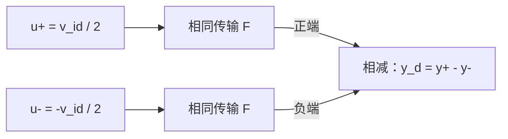

# L011 | 多项式非线性与谐波失真

- 教材：§2.2 导言与 §2.2.1 *Harmonic Distortion*，印刷第 14–16 页／PDF 第 39–41 页，PDF 页从 1 开始计数。主要依据原书式 (2.25)–(2.32)、图 2.7–2.8、例 2.5–2.6。
- 先修课：L007 的余弦乘积与谱线系数；L010 的无记忆非线性、输入边界与奇对称。下面补齐本课所需的三角恒等式和差分定义。
- 学习量：约 60 分钟；先修与引入 5 分钟、物理解释 10 分钟、建模推导 20 分钟、两道例题 20 分钟、误区与检查 5 分钟。教材阅读与课后练习另计。
- 状态：2026-10-08 已生成并自查；学习掌握情况未评估。
- 公式约定：行内使用 `$...$`，独立公式使用 `$$...$$` 并以 `L011-01` 起连续编号。电压以 V 为单位，正弦幅度默认**峰值**；RMS 是有效值。频率 $f$ 用 Hz，角频率 $\omega$ 用 rad/s。先分析单端电压，再明确转换到差分电压。谱图采用有符号的余弦系数，不是功率谱密度（PSD）。

## 1. 本课目标

学完后，你应能：

1. 将单音输入代入三阶多项式，独立展开二次项和三次项。
2. 分离输出的直流、基波、二次与三次谐波，算出带符号系数、峰值和 RMS。
3. 从输入正负半周的响应解释偶对称、奇对称，以及理想差分输出为何消除偶次项。
4. 在明确的两支增益失配模型下求出残余二次谐波，并指出该模型适用的条件。
5. 用教材的混频与发射机例子解释：谐波是否重要，取决于它最终落到哪里。

**先修补齐：**基波（fundamental）是与输入单音同频的成分；第 $n$ 次谐波（harmonic）位于输入频率的 $n$ 倍，$n$ 为正整数。余弦平方不再正负对称，会产生平均值；余弦立方仍正负对称，却不再保持纯正弦形状。对一个时不变、无记忆的非线性模型，这些变化可以直接通过代数求出。

## 2. 从一个具体问题开始

给一个放大器送入 50 mV 峰值的纯余弦。假设小信号电压增益为 10，第一反应是：“输出就是 500 mV 峰值的余弦。”

但如果放大器的传输曲线有弯曲，输出还可能出现：

- 一个输入没有的直流偏移；
- 位于两倍、三倍输入频率处的谐波；
- 一个**仍在原频率上、却已偏离 500 mV 的基波**。

本课把这些成分逐项算出来。最需要抓住的是：**产生新谐波与改变原有基波，是同一个非线性项可以同时造成的两种结果。**

## 3. 物理过程与直觉

### 3.1 为什么传输曲线弯曲会改变频谱？

晶体管电流与端电压的关系通常是弯曲的。偏置附近很小的输入变化可以用切线近似；输入摆幅变大后，波形会走到切线两侧的弯曲区域。固定负载把电流变化转成输出电压，因此整个电压传输也会偏离一条直线。

先看二次项。输入为正或为负，平方都为正。若二次项系数为正，正半周被向上推，负半周也被向上推；正负半周不再围绕原工作点完全对称。结果既有平均值变化，也有每个输入周期重复两次的变化。

再看三次项。输入反号时立方也反号，因此单独的三次项不会造成这种上下不对称。可是立方会更强地改变波峰附近、较弱地改变零点附近，输出就不再是原来的纯余弦。

对非反相增益为正的放大器，负的三次系数会削弱正峰、抬高负峰，使峰部趋于平坦。要重构这个形状，需要基波变化和三次谐波共同作用。

### 3.2 教材为何提醒“别轻易忽略谐波”？

原书印刷第 15 页举例：2.4 GHz 放大器的二次谐波在 4.8 GHz，窄带响应可能强烈衰减它。但这不能推出所有射频电路中的谐波都无关紧要。

原书图 2.7，印刷第 15 页／PDF 第 40 页。例 2.5 的乘法器会把一个端口已有的三次谐波继续搬移，形成新的杂散（spurious component）。滤波判断必须针对**搬移之后**的位置，具体计算见第 4.8 节。

原书图 2.8，印刷第 16 页／PDF 第 41 页。例 2.6 讨论一个 900 MHz、向天线送出 1 W 的 GSM 发射机：二次谐波在 1.8 GHz，六次谐波在 5.4 GHz。谐波可能影响其他频段的使用者；即使未落入图中标出的业务频段，也需要考虑带外发射约束。

这里保留原书出版时的频段示意，图中的业务标注不作为现行频谱分配或法规限值，谱线高度也不能用于定量推算谐波功率。三阶模型只能算到三次谐波；图中的四至六次谐波用于说明真实电路还存在更高阶效应。

## 4. 建模与逐步推导

### 4.1 先固定工作点、端口与模型

考虑一个电压输入、电压输出的放大器。输入和输出单端电压都相对共同参考地测量，电源、偏置、源条件与负载保持不变。

用 $V_{\mathrm{in},Q}$、$V_{\mathrm{out},Q}$ 表示无交流输入时的直流工作点；$v_{\mathrm{in}}(t)$、$v_{\mathrm{out}}(t)$ 表示实际端口电压，$t$ 为时间。本课分析相对于该工作点的增量 $x(t)$、$y(t)$：

$$
x(t)=v_{\mathrm{in}}(t)-V_{\mathrm{in},Q},\qquad
y(t)=v_{\mathrm{out}}(t)-V_{\mathrm{out},Q}.
\tag{L011-01}
$$

采用原书式 (2.25) 的三阶模型：

$$
y(t)\approx F\bigl(x(t)\bigr)
=\alpha_1x(t)+\alpha_2x^2(t)+\alpha_3x^3(t).
\tag{L011-02}
$$

$F$ 表示静态传输函数，不是噪声因子；$\alpha_1$、$\alpha_2$、$\alpha_3$ 分别为一次、二次、三次系数。输入输出都为电压，因而它们的单位必须是：

$$
[\alpha_1]=1,\qquad
[\alpha_2]=\mathrm{V}^{-1},\qquad
[\alpha_3]=\mathrm{V}^{-2}.
\tag{L011-03}
$$

方括号表示量纲／单位。三项相乘后都得到 V，才能相加。$\alpha_1$ 对应这个模型在零输入附近的小信号电压增益。

模型的适用条件要同时满足：

- **无记忆近似：**在所考察条件下，输入输出关系可以由当前输入描述，储能和频率相关效应对非线性结果的影响可以忽略。
- **三阶截断可信：**在给定摆幅范围内，更高次项不足以改变当前结论；不能据此预测严重限幅或饱和。
- **固定系数：**偏置、负载等条件保持不变；原书第 14 页脚注特别说明，系数可来自所关注摆幅范围内的拟合，不一定等于零点处泰勒展开的系数。

本课求模型本身的输出。若实际电路在各谐波频率具有不同响应，应另外纳入动态效应。只有在“非线性源后接一个独立线性滤波器”的模型成立时，才可以先算谐波、再乘该滤波器的响应。

固定工作点只减去一次；输入产生的新直流分量仍属于输出响应。

### 4.2 单音输入：先定义幅度

设 $A\geq0$ 为输入峰值，$f>0$ 为输入频率：

$$
x(t)=A\cos\omega t,\qquad \omega=2\pi f.
\tag{L011-04}
$$

本课以此输入余弦作为相位参考；不能把 $A$ 直接当成 RMS 后代入。

### 4.3 二次项：为何同时得到直流和二次谐波？

由二倍角关系解出余弦平方：

$$
\cos2\theta=2\cos^2\theta-1
\quad\Longrightarrow\quad
\cos^2\theta=\frac{1+\cos2\theta}{2}.
\tag{L011-05}
$$

$\theta$ 是无量纲相位，此处取 $\theta=\omega t$。所以输入平方的一半是常数，另一半在 $2\omega$ 变化。系数为负时，这两个带符号的输出系数都会反号。

### 4.4 三次项：为何不只产生三次谐波？

由三倍角关系解出余弦立方：

$$
\cos3\theta=4\cos^3\theta-3\cos\theta
\quad\Longrightarrow\quad
\cos^3\theta=\frac{3\cos\theta+\cos3\theta}{4}.
\tag{L011-06}
$$

这一步决定了三次项的两个去向：$3/4$ 的余弦系数落在基波，$1/4$ 落在三次谐波。不能把整个三次项都放到三倍频。

代入式 (02)，对应原书式 (2.26)–(2.28)：

$$
\begin{aligned}
y(t)&\approx\alpha_1A\cos\omega t
+\frac{\alpha_2A^2}{2}(1+\cos2\omega t)
+\frac{\alpha_3A^3}{4}(3\cos\omega t+\cos3\omega t)\\
&=\frac{\alpha_2A^2}{2}
+\left(\alpha_1A+\frac{3\alpha_3A^3}{4}\right)\cos\omega t
+\frac{\alpha_2A^2}{2}\cos2\omega t
+\frac{\alpha_3A^3}{4}\cos3\omega t.
\end{aligned}
\tag{L011-07}
$$

为便于比较，定义 $C_0$ 为直流值，$C_1,C_2,C_3$ 为各余弦的**带符号系数**：

$$
\begin{aligned}
C_0&=\frac{\alpha_2A^2}{2},&
C_1&=\alpha_1A+\frac{3\alpha_3A^3}{4},\\
C_2&=\frac{\alpha_2A^2}{2},&
C_3&=\frac{\alpha_3A^3}{4}.
\end{aligned}
\tag{L011-08}
$$

| 成分 | 频率 | 来自哪些项 | 含义 |
|---|---|---|---|
| 直流 | 0 | 二次项 | 相对原工作点的平均输出变化 |
| 基波 | $f$ | 一次项与三次项 | 原信号频率上的响应已经受到非线性影响 |
| 二次谐波 | $2f$ | 二次项 | 本模型中的偶次失真 |
| 三次谐波 | $3f$ | 三次项 | 本模型中的奇次失真 |

在本课三阶多项式模型中，$C_0=C_2$。这不意味着有滤波、交流耦合或更高阶效应的真实电路也必须保留相同的直流和二次谐波幅度。

### 4.5 符号、峰值、RMS 与相对谐波

令 $V_{n,p}$、$V_{n,\mathrm{rms}}$ 分别为第 $n$ 个交流分量的非负峰值和 RMS；$H_2,H_3$ 为相对于实际输出基波的谐波幅度比：

$$
V_{n,p}=|C_n|,\qquad
V_{n,\mathrm{rms}}=\frac{|C_n|}{\sqrt2}\quad(n=1,2,3),\qquad
H_2=\frac{|C_2|}{|C_1|},\quad
H_3=\frac{|C_3|}{|C_1|}.
\tag{L011-09}
$$

负的 $C_n$ 表示相对于对应的 $\cos(n\omega t)$ 反相 $180^\circ$；它不表示负功率。直流的 RMS 是 $|C_0|$，不除以 $\sqrt2$。基波为零时，相对基波的这些指标无定义。

补充一个常用报告方式：dBc 是相对于基波功率的 dB 值。若各频率的电压都对应同一个实电阻 $R$，则正弦功率为 $P_n=C_n^2/(2R)$：

$$
L_{H_n}=10\log_{10}\frac{P_n}{P_1}
=20\log_{10}\frac{|C_n|}{|C_1|}
\quad(n=2,3).
\tag{L011-10}
$$

$L_{H_n}$ 表示第 $n$ 次谐波的 dBc 值。若谐波处负载不同，不能直接把电压比当成功率比。

### 4.6 偶对称、奇对称与差分消除

任何静态传输函数都可按输入反号的行为分为偶部 $F_{\mathrm e}$ 与奇部 $F_{\mathrm o}$：

$$
F_{\mathrm e}(x)=\frac{F(x)+F(-x)}2,\qquad
F_{\mathrm o}(x)=\frac{F(x)-F(-x)}2.
\tag{L011-11}
$$

对本课多项式：

$$
F_{\mathrm e}(x)=\alpha_2x^2,\qquad
F_{\mathrm o}(x)=\alpha_1x+\alpha_3x^3.
\tag{L011-12}
$$

偶对称意味着输入反号后输出不变；奇对称意味着输入反号后输出也反号。**奇对称不等于线性**：$x^3$ 就是反例。

现在构造一个对称的双支路行为模型。两支有相同传输函数和工作点，输入共模保持固定；输出差分量定义为正支输出减负支输出：

图为补充教学框图。$v_{\mathrm{id}}$ 为总差分输入电压，$u_+,u_-$ 是两支对地的输入增量；$y_+,y_-$ 是两支输出增量，$y_{\mathrm d}$ 为差分输出：

$$
u_+=\frac{v_{\mathrm{id}}}{2}=u,\qquad
u_-=-\frac{v_{\mathrm{id}}}{2}=-u,\qquad
y_{\mathrm d}=F(u)-F(-u).
\tag{L011-13}
$$

把正负输入分别代入，再相减：

$$
\begin{aligned}
y_{\mathrm d}
&=(\alpha_1u+\alpha_2u^2+\alpha_3u^3)
-(-\alpha_1u+\alpha_2u^2-\alpha_3u^3)\\
&=2\alpha_1u+2\alpha_3u^3
=\alpha_1v_{\mathrm{id}}+\frac{\alpha_3}{4}v_{\mathrm{id}}^3.
\end{aligned}
\tag{L011-14}
$$

偶次项是两支相同的贡献，相减后消失；奇次项是两支相反的贡献，相减后相加。输出共模增量 $y_{\mathrm{cm}}$ 则是两支输出的平均值：

$$
y_{\mathrm{cm}}=\frac{F(u)+F(-u)}2
=\alpha_2u^2=\frac{\alpha_2v_{\mathrm{id}}^2}{4}.
\tag{L011-15}
$$

所以偶次分量可以仍存在于各支和共模输出。差分读出将它抵消，需要两支对称且读出准确。

设差分输入为 $v_{\mathrm{id}}=A_{\mathrm d}\cos\omega t$，$A_{\mathrm d}$ 是**总差分峰值**，每支峰值为 $A_{\mathrm d}/2$。用下标 d 标记差分输出的余弦系数：

$$
C_{0,\mathrm d}=C_{2,\mathrm d}=0,\qquad
C_{1,\mathrm d}=\alpha_1A_{\mathrm d}+\frac{3\alpha_3A_{\mathrm d}^3}{16},\qquad
C_{3,\mathrm d}=\frac{\alpha_3A_{\mathrm d}^3}{16}.
\tag{L011-16}
$$

分母 16 来自“每支只得到总差分输入的一半，再将两支相减”。若把总差分峰值直接代入单支公式，系数就错了。

### 4.7 两支增益失配后，二次谐波怎样回来？

先明确“增益失配”的具体含义。本课例题 B 采用两支完整输出分别乘 $g_+$、$g_-$ 的模型：

$$
g_+=1+\frac\varepsilon2,\qquad
g_-=1-\frac\varepsilon2,\qquad
y_{\mathrm d}=g_+F(u)-g_-F(-u).
\tag{L011-17}
$$

$g_+,g_-$ 为无量纲支路增益因子；$\varepsilon$ 为两支增益之差相对于平均增益的归一化失配。$\varepsilon=0.02$ 表示两支分别为 1.01 与 0.99。

整理时先把理想差分与失配贡献分开：

$$
\begin{aligned}
y_{\mathrm d}
&=F(u)-F(-u)+\frac\varepsilon2\,[F(u)+F(-u)]\\
&=2\alpha_1u+2\alpha_3u^3+\varepsilon\alpha_2u^2\\
&=\alpha_1v_{\mathrm{id}}+\frac{\alpha_3}{4}v_{\mathrm{id}}^3
+\frac{\varepsilon\alpha_2}{4}v_{\mathrm{id}}^2.
\end{aligned}
\tag{L011-18}
$$

这揭示了失配的路径：原来的偶部／共模分量，由不平衡读出泄漏进差分输出。对单音差分输入：

$$
C_{0,\mathrm d}=C_{2,\mathrm d}
=\frac{\varepsilon\alpha_2A_{\mathrm d}^2}{8},\qquad
C_{1,\mathrm d}=\alpha_1A_{\mathrm d}+\frac{3\alpha_3A_{\mathrm d}^3}{16},\qquad
C_{3,\mathrm d}=\frac{\alpha_3A_{\mathrm d}^3}{16}.
\tag{L011-19}
$$

因此残余二次谐波幅度比为：

$$
H_{2,\mathrm d}
=\frac{|\varepsilon\alpha_2|A_{\mathrm d}^2/8}
{\left|\alpha_1A_{\mathrm d}+3\alpha_3A_{\mathrm d}^3/16\right|}.
\tag{L011-20}
$$

这里的结论依赖于两支**整体传输同时缩放**。若仅线性系数不同，二次系数仍相等，不能据线性增益失配直接断言存在二次谐波。

更一般地，令 $\alpha_{j,+},\alpha_{j,-}$ 为两支第 $j$ 阶系数，保持输入为 $+u,-u$：

$$
y_{\mathrm d}
=(\alpha_{1,+}+\alpha_{1,-})u
+(\alpha_{2,+}-\alpha_{2,-})u^2
+(\alpha_{3,+}+\alpha_{3,-})u^3.
\tag{L011-21}
$$

实际残余二次项取决于两支二次系数的差、输入平衡以及输出读出的对称性。真实差分对的具体系数，需要从其电路、偏置和器件模型求得。

### 4.8 用原书例 2.5 检查谐波的去向

图 2.7 的两个输入为 $x_1=A_1\cos\omega_1t$、$x_2=A_2\cos\omega_2t$，$A_1,A_2$ 为电压峰值，$\omega_1,\omega_2$ 为角频率。理想乘法器常数 $k$ 的单位为 $\mathrm{V}^{-1}$：

$$
y=kx_1x_2
=\frac{kA_1A_2}{2}
\left[\cos(\omega_1+\omega_2)t+\cos(\omega_1-\omega_2)t\right].
\tag{L011-22}
$$

这对应原书式 (2.29)–(2.30)。现在第二端口存在三次谐波。用 $B$ 表示其实际基波系数，$D$ 表示其三次谐波系数，端口有效波形记为 $b(t)$：

$$
b(t)=B\cos\omega_2t+D\cos3\omega_2t.
\tag{L011-23}
$$

原书式 (2.31)–(2.32) 为突出新杂散，保留原基波 $A_2$ 并加入三次谐波；在完整的端口三阶模型中，若一次、三次系数为 $\beta_1,\beta_3$，则：

$$
B=\beta_1A_2+\frac{3\beta_3A_2^3}{4},\qquad
D=\frac{\beta_3A_2^3}{4}.
\tag{L011-24}
$$

$\beta_1$ 无量纲、$\beta_3$ 单位为 $\mathrm{V}^{-2}$；此处为突出三次项，令二次系数为零。用实际基波 $B$ 可以保留本课强调的基波修正，同时得到与原书相同的新杂散频率：

$$
\begin{aligned}
y={}&\frac{kA_1B}{2}
\left[\cos(\omega_1+\omega_2)t+\cos(\omega_1-\omega_2)t\right]\\
&+\frac{kA_1D}{2}
\left[\cos(\omega_1+3\omega_2)t+\cos(\omega_1-3\omega_2)t\right].
\end{aligned}
\tag{L011-25}
$$

原书取 $f_1=850\ \mathrm{MHz}$、$f_2=900\ \mathrm{MHz}$：

$$
\begin{aligned}
f_1+f_2&=1750\ \mathrm{MHz},& |f_1-f_2|&=50\ \mathrm{MHz},\\
f_1+3f_2&=3550\ \mathrm{MHz},& |f_1-3f_2|&=1850\ \mathrm{MHz}.
\end{aligned}
\tag{L011-26}
$$

对选择 1750 MHz 和频输出的应用，1850 MHz 杂散仅相距 100 MHz。原书据此提醒滤波可能困难；具体能否抑制到目标值，仍需要实际通带、阻带和滤波器阶数等条件。

这与 L010 一致：固定 LO 时，乘法器对另一输入仍可线性。LO 端口已有的谐波，会通过这条线性时变路径被搬移。

## 5. 公式说明与设计取舍

### 5.1 幅度扩大后，谐波如何变化？

式 (08) 中，二次谐波峰值与 $A^2$ 成正比，三次谐波峰值与 $A^3$ 成正比。因此，在系数固定、模型仍可信时，输入峰值翻倍，二次谐波峰值变为四倍，三次谐波峰值变为八倍。

但相对失真还有分母。只有当基波主要由一次项贡献，即 $|3\alpha_3A^2/4|\ll|\alpha_1|$ 时，$H_2$ 才近似与 $A$ 成正比，$H_3$ 才近似与 $A^2$ 成正比。基波压缩后，应使用实际 $C_1$。

### 5.2 三个边界检验

- 当 $A$ 趋于零且 $\alpha_1\ne0$，基波趋于线性响应，两个相对谐波均趋于零。
- 当 $\alpha_2=0$，本模型的直流与二次谐波消失；$\alpha_3$ 仍可改变基波并产生三次谐波。
- 当 $\varepsilon=0$，对称差分输出的偶次项消失；两支各自的偶次项和奇次失真不必消失。

### 5.3 改善方法的具体代价

减小输入摆幅可以降低非线性贡献，但也减小有用输出；若噪声条件不变，信噪比可能变差。提高两支匹配和读出平衡可以抑制偶次泄漏，却不能自动消除奇次失真。输出滤波能衰减带外谐波，但不能恢复已经被三次项改变的同频基波；实际滤波器还会引入插入损耗与带宽限制。

若增大器件尺寸改善随机匹配，通常也增加寄生电容、面积和驱动负担。选择方法时，需要明确当前主要受偶次泄漏、奇次失真、带宽还是信号幅度限制。

## 6. 例题一：求单端输出的四个频率分量

**来源：按 COURSE.md 的例题 A 自编。**采用式 (02) 的电压模型，给定 $\alpha_1=10$、$\alpha_2=2\ \mathrm{V}^{-1}$、$\alpha_3=-20\ \mathrm{V}^{-2}$。输入峰值 $A=0.050\ \mathrm V$，补充取 $f=100\ \mathrm{MHz}$，输出负载条件已包含在模型系数中。

求直流、基波、二次与三次谐波系数，各交流成分的 RMS，并解释三次项对基波的影响。

**第一步：分别算幂次，再代入式 (08)。**

$$
\begin{aligned}
A^2&=0.0025\ \mathrm{V}^2,& A^3&=0.000125\ \mathrm{V}^3,\\
C_0=C_2&=\frac{(2)(0.0025)}2\ \mathrm V
=0.002500\ \mathrm V,\\
C_1&=10(0.050)\ \mathrm V
+\frac{3(-20)(0.000125)}4\ \mathrm V
=0.498125\ \mathrm V,\\
C_3&=\frac{(-20)(0.000125)}4\ \mathrm V
=-0.000625\ \mathrm V.
\end{aligned}
\tag{L011-27}
$$

**第二步：写完整输出，保留系数符号。**

$$
y(t)\approx0.002500
+0.498125\cos\omega t
+0.002500\cos2\omega t
-0.000625\cos3\omega t
\quad\mathrm V.
\tag{L011-28}
$$

**第三步：区分带符号系数与非负幅度。**

| 分量 | 频率 | 带符号系数 | 非负峰值／直流绝对值 | RMS |
|---|---|---:|---:|---:|
| 直流 | 0 | +2.500 mV | 2.500 mV | 2.500 mV |
| 基波 | 100 MHz | +498.125 mV | 498.125 mV | 352.228 mV |
| 二次谐波 | 200 MHz | +2.500 mV | 2.500 mV | 1.768 mV |
| 三次谐波 | 300 MHz | −0.625 mV | 0.625 mV | 0.442 mV |

图为自绘的离散余弦系数谱，三次谐波画到零线下方表示负系数。若改画双边傅里叶谱，每个非零频率的正、负频率系数分别是这里余弦系数的一半；直流保持原值。

以实际基波归一化：$H_2=0.5019\%$，$H_3=0.1255\%$。在同一实电阻下，分别约为 $-45.99\ \mathrm{dBc}$ 和 $-58.03\ \mathrm{dBc}$。

**解释与复核。**三次项对基波的贡献是 −1.875 mV，而三次谐波系数是 −0.625 mV，前者恰为后者三倍。基波从线性预测的 500 mV 降到 498.125 mV，降低 0.375%。各项单位都是 V；把输入缩小十倍时，二次项缩小百倍、三次项缩小千倍，满足小信号极限。

## 7. 例题二：对称差分与增益失配

**来源：按 COURSE.md 的例题 B 自编。**两支传输函数与例题一相同，输入为等幅反相单音，总差分峰值 $A_{\mathrm d}=0.100\ \mathrm V$，频率仍为 100 MHz，每支实际峰值为 0.050 V。采用式 (17) 的整体输出增益失配模型。

先求完全匹配时的差分输出，再令 $\varepsilon=0.020$，求残余直流、二次谐波及其相对基波幅度。

**第一步：完全匹配时逐项相减。**每支幅度与例题一相同。直流与二次谐波在两支同相，相减消失；基波与三次谐波反相，相减加倍：

$$
\begin{aligned}
C_{0,\mathrm d}=C_{2,\mathrm d}&=0,\\
C_{1,\mathrm d}&=2(0.498125)=0.996250\ \mathrm V,\\
C_{3,\mathrm d}&=2(-0.000625)=-0.001250\ \mathrm V.
\end{aligned}
\tag{L011-29}
$$

差分输出没有二次项，但仍存在三次谐波与基波修正。因此“差分消除非线性”是错误结论。

**第二步：两支完整输出乘 1.01 与 0.99，再相减。**偶次成分只剩两支增益之差乘以单支贡献：

$$
\begin{aligned}
C_{0,\mathrm d}=C_{2,\mathrm d}
&=(1.01-0.99)(0.002500)\ \mathrm V\\
&=0.000050\ \mathrm V=50.0\ \mu\mathrm V.
\end{aligned}
\tag{L011-30}
$$

奇次成分乘以两支增益之和，仍为原来的两倍。这个结论是本题对称缩放模型的结果：

$$
y_{\mathrm d}(t)\approx
0.000050+0.996250\cos\omega t
+0.000050\cos2\omega t
-0.001250\cos3\omega t
\quad\mathrm V.
\tag{L011-31}
$$

**第三步：用差分基波作分母。**

$$
H_{2,\mathrm d}=\frac{50.0\ \mu\mathrm V}{0.996250\ \mathrm V}
\approx5.019\times10^{-5}=0.005019\%,\qquad
L_{H_2,\mathrm d}\approx-85.99\ \mathrm{dBc}.
\tag{L011-32}
$$

残余二次谐波的 RMS 为 $35.36\ \mu\mathrm V$。三次谐波相对基波仍为 0.1255%，与单支相比没有改善：它和基波都被相减操作加倍了。

**条件变化。**在总差分输入保持不变时，把 $\varepsilon$ 从 0.020 降到 0.010，残余直流与二次谐波峰值从 50.0 μV 降到 25.0 μV，二次谐波相对功率改善约 6.02 dB；本模型中的基波与三次谐波保持原值。

**物理含义与极限检验。**匹配改善抑制的是偶部向差分端的泄漏。$\varepsilon$ 趋于零时残余偶次项趋于零；若 $\alpha_2=0$，即使这个增益失配仍存在，也没有可泄漏的二次项。若只有一次系数失配、二次系数仍相同，应回到式 (21) 判断，不能套用 50 μV 的结论。

## 8. 常见误区

1. **“三次项只在三倍频出现。”**错在展开。例题一中它在基波贡献 −1.875 mV，在三倍频贡献 −0.625 mV。
2. **“负的谐波幅度意味着负功率。”**错在把带符号余弦系数当成幅度。−0.625 mV 对应峰值 0.625 mV、相位反转，功率仍非负。
3. **“奇对称就线性，差分就完全无失真。”**错在判定。三次项是奇对称非线性，理想差分仍保留它。
4. **“总差分输入峰值就是每支输入峰值。”**错在端口定义。100 mV 总差分峰值在本题中意味着每支 50 mV。
5. **“有任何线性增益失配，就必然有二次谐波。”**错在模型。式 (21) 中二次项由两支二次系数之差决定。
6. **“滤掉谐波以后，基波增益就恢复了。”**错在频率分离。线性滤波不能把已经变小的同频基波自动恢复成原来的线性响应。
7. **“二次项永远只生成二倍频。”**错在输入条件。本课结论针对零均值单音。若输入含直流偏移，平方展开还包含与原单音同频的交叉项。
8. **“频率远离基波就一定无害。”**错在系统位置。原书例 2.5 中 LO 的三次谐波经乘法搬移，产生离期望和频较近的杂散。

## 9. 课后练习

三题均为自编。请先独立写出过程，再看提示与解答。

**1. 概念题。**对零均值单音，解释二次项为何产生直流，而三次项不产生直流。若 $\alpha_2=0$、$\alpha_3\ne0$，能否根据“没有二次谐波”断言系统线性？为什么？

**2. 计算题。**沿用例题一的系数与 100 MHz 输入，把单端峰值改为 $A=0.100\ \mathrm V$。求 $C_0,C_1,C_2,C_3$，以及 $H_2,H_3$。分别比较两种谐波的绝对峰值增长倍数和相对基波幅度增长倍数。

**3. 分析题。**沿用例题二的全部模型，把总差分峰值改为 $A_{\mathrm d}=0.200\ \mathrm V$，先保持 $\varepsilon=0.020$：求残余二次谐波峰值、差分基波和 $H_{2,\mathrm d}$。若只能将 $\varepsilon$ 减半，二次谐波的绝对峰值和相对失真是否都回到例题二原值？说明原因与改善匹配的一个实际代价。

### 提示

1. 看输入反号后平方、立方是否反号；对正负半周作平均。
2. 先算平方和立方，再用实际基波作归一化，别直接按线性增益估分母。
3. 每支峰值是总差分峰值的一半；残余二次谐波随失配线性变化、随输入峰值平方变化。

### 练习解答（先独立作答，再阅读）

**1. 概念题解答。**平方在正负半周同号，周期平均不为零；立方在正负半周反号，半周期后相互抵消，周期平均为零。$\alpha_2=0$ 只消除了本模型的偶部；非零三次项仍使输入缩放不满足线性叠加，还会改变基波并产生三次谐波。

**2. 计算题解答。**代入式 (08)：

$$
\begin{aligned}
C_0=C_2&=\frac{2(0.100)^2}{2}=0.0100\ \mathrm V,\\
C_1&=10(0.100)+\frac{3(-20)(0.100)^3}{4}
=0.9850\ \mathrm V,\\
C_3&=\frac{(-20)(0.100)^3}{4}=-0.00500\ \mathrm V,\\
H_2&=\frac{0.0100}{0.9850}=1.0152\%,\qquad
H_3=\frac{0.00500}{0.9850}=0.5076\%.
\end{aligned}
\tag{L011-33}
$$

二次谐波峰值从 2.5 mV 到 10 mV，增长 4 倍；三次谐波峰值从 0.625 mV 到 5 mV，增长 8 倍。相对幅度比分别增长约 2.023 倍、4.046 倍，略大于简单小信号估计的 2 倍、4 倍，因为基波没有严格随输入翻倍。

**3. 分析题解答。**用式 (19)–(20)：

$$
\begin{aligned}
C_{2,\mathrm d}&=\frac{(0.020)(2)(0.200)^2}{8}
=0.000200\ \mathrm V=200\ \mu\mathrm V,\\
C_{1,\mathrm d}&=10(0.200)+\frac{3(-20)(0.200)^3}{16}
=1.9700\ \mathrm V,\\
H_{2,\mathrm d}&=\frac{0.000200}{1.9700}
\approx0.01015\%,\\
\varepsilon=0.010:\quad C_{2,\mathrm d}&=100\ \mu\mathrm V,\qquad
H_{2,\mathrm d}\approx0.005076\%.
\end{aligned}
\tag{L011-34}
$$

失配减半后，二次谐波绝对峰值仍是原例的 2 倍；相对失真接近、但略高于原例的 0.005019%。原因是输入翻倍使二次项增为 4 倍，失配减半只抵消其中一半；基波约翻倍，但三次项使它增长略少于 2 倍。

在这一模型下，恢复原来的二次谐波**绝对峰值**需要把失配降到原来的四分之一，即 $\varepsilon=0.005$。若只要求恢复相对失真，则失配需略小于 0.010。实际改善匹配可增加器件面积，同时增加寄生电容，影响带宽或驱动负担。

## 10. 掌握检查与下一课

请尝试不看正文完成以下四项：

1. 从二倍角、三倍角关系出发，推导式 (07)，标出每个项的频率和单位。
2. 解释为什么三次项在基波的贡献是其三次谐波系数的三倍，而不是把三次项全部归入三倍频。
3. 写出两支输入为 $\pm v_{\mathrm{id}}/2$ 的差分相减，证明偶次项消失，并说明它们仍可能出现在哪个输出量中。
4. 在整体支路增益失配模型下推导残余二次项，然后解释“仅一次系数失配”为什么不能直接套用同一结论。

四项检查展开、频率分离、物理解释与条件迁移。当前没有你的独立解题证据，掌握情况保持未评估。

下一课 **L012：增益压缩、阻塞与去敏**。带走式 (08) 的基波系数：三次项已经改变基波。下一课将由它求单音压缩点，并解释强阻塞信号为什么可以削弱另一个弱信号的增益。

## 11. 出处与自查

- 原书 §2.2 导言与 §2.2.1，印刷 14–16／PDF 39–41：式 (2.25) 的模型与拟合脚注、式 (2.26)–(2.28) 的单音展开、偶次项与奇对称关系。原页已经读取并渲染核查。
- 原书例 2.5 与图 2.7，印刷 15–16／PDF 40–41：式 (2.29)–(2.32) 的乘法搬移及 850／900 MHz 的杂散频率；本课用实际基波系数补充完整三阶端口模型，并明确与原书突出杂散的写法区别。
- 原书例 2.6 与图 2.8，印刷 16／PDF 41：900 MHz 发射信号的谐波频率示意。图 2.7、2.8 均由项目中的教材 PDF 截取；频段标注保留原书背景。
- 补充推导：峰值／RMS／dBc 的转换、偶部与奇部分解、两支整体增益缩放的失配模型、一般支路系数失配式。两道完整例题及三道课后练习均为自编，按课程备课卡完成。
- 数值复核代码为 `lessons/L011/check_values.py`，结果为 `lessons/L011/verification.json`；通过整周期平均与余弦投影独立核对解析分量，并检查零失配边界。该复核是静态多项式行为模型计算。
- 数学表达式已通过 KaTeX 渲染检查；34 个独立公式连续编号。原书截图、余弦谱的符号与系数、差分输入的一半幅度、全部例题和练习关键数值均已核查。

## 用户笔记与作业

尚未收到本课笔记或作业；后续内容保留于此。
